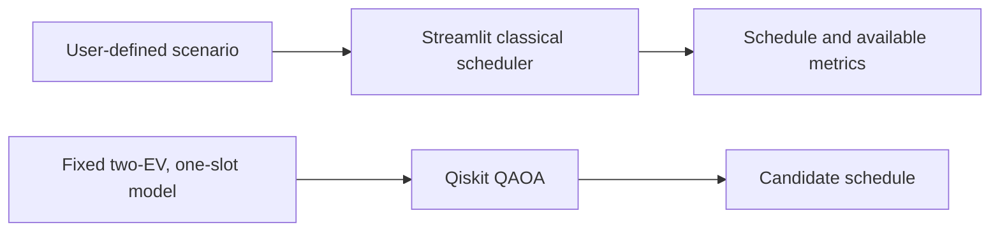

<div align="center">

# Qubits Nexus

**VTU-QFF-HC-0029** &nbsp;|&nbsp; Tier: **Online**

</div>

---

<div align="center">

| | |
| :--- | :--- |
| **Team** | Qubits Nexus |
| **Team ID** | VTU-QFF-HC-0029 |
| **Tier** | Online |
| **Repository** | [vtu-hc-qubits-nexus](https://github.com/vtu-qiskit-fall-fest-2026/vtu-hc-qubits-nexus.git) |
| **Organisation** | [vtu-qiskit-fall-fest-2026](https://github.com/vtu-qiskit-fall-fest-2026) |
| **Event** | VTU-QFF Hackathon — VTU-Qiskit Fall Fest 2026 |

</div>

---

## 📌 Table of Contents

- [Team Members](#-team-members-github-ids)
- [Problem Statement](#-problem-statement)
- [Proposed Solution](#-proposed-solution)
- [Approach & Architecture](#-approach--architecture)
- [Tech Stack](#-tech-stack)
- [Project Structure](#-project-structure)
- [How to Run](#-how-to-run)
- [How to Push Code](#-how-to-push-code)
- [Submission Checklist](#-submission-checklist)
- [Resources](#-resources)
- [License](#-license)

---

## 👥 Team Members (GitHub IDs)

> Members are added to this repository as **collaborators** and must accept the
> GitHub invitation before they can push. Add your GitHub username below.

| # | Name | GitHub Username | Role |
| :-- | :--- | :--- | :--- |
| 1 | _Aliya Mulla_ | _aliyamulla098-spec_ | _Team Lead_ |
| 2 | _Arsin Imtiyaz Karadagi_ | _Arsinkaradagi_ | _Developer_ |
| 3 | _Zaveerya Mulla_ | _ZaveeryaMulla_ | _Developer_ |

<!--
Optional: add a plain list instead of the table above.
- @username1
- @username2
-->

---

## ❓ Problem Statement

<!--
State the problem you are solving. Be specific: what is broken or missing,
who experiences it, and why does it matter. Link to the official problem
statement from the brief if one applies.
-->

**Problem:** _Shared EV charging facilities have limited grid capacity, while vehicles have different energy requests, priorities, and departure times. A charging schedule must allocate available capacity without exceeding the grid limit and should make clear how much demand each vehicle receives._

**Why it matters:** _Poor scheduling can create high demand during a time slot or leave some vehicles short of their requested energy. Comparing scheduling approaches can help facility operators understand these trade-offs._

**Track / Category:** _Online · Track 6 · Quantum Applications for Climate Change and Sustainability_

---

## 💡 Proposed Solution

<!--
Describe your solution. Keep it concrete: the core idea, the user flow, and
the quantum/ML technique you are applying.
-->

**Solution:** _Q-Charge Fair is a Streamlit prototype for exploring EV charging scenarios and viewing schedules from a classical greedy scheduler. It also includes a small QAOA demonstration that solves a fixed binary charging example using Qiskit’s local statevector simulator._

**Key idea:** Present user-configurable classical schedules alongside a separate QAOA demonstration using a fixed, small charging model.

**Why this works:** _The prototype makes scheduling trade-offs visible and provides a small example of encoding EV charging decisions as a binary optimization problem. It investigates QAOA without claiming quantum advantage._

---

## 🧩 Approach & Architecture

<!--
Walk through how it works. A simple pipeline diagram in text or Mermaid is ideal.
-->



1. **Input** — _The Streamlit interface accepts charging scenario values such as grid capacity and vehicle requirements._
2. **Preprocessing** — _The QAOA example uses two EVs, one time slot, and binary 1 kWh charging decisions. It is a fixed demonstration and does not represent every interactive scenario._
3. **Quantum core** — Qiskit QAOA with one layer (`reps=1`), COBYLA, and the local `StatevectorSampler`. The small model includes vehicle energy-request constraints, a grid limit, and priority-weighted charging rewards.
4. **Post-processing** — _The selected binary values are decoded into charging assignments_
5. **Output** — _The app displays schedules and available performance summaries for the demo. The QAOA result is a candidate from a small simulator example, not evidence of quantum advantage._

---

## 🛠️ Tech Stack

| Layer | Technology |
| :--- | :--- |
| Language | Python 3.11+ |
| Quantum SDK | Qiskit |
| Optimisation | Qiskit Optimization, Qiskit Algorithms (QAOA, COBYLA) |
| Web App | Streamlit |
| Environment | VS Code, `venv` |
| Version control | Git + GitHub |
| Data and charts | pandas, plotly |

---

## 📁 Project Structure

```text
vtu-hc-qubits-nexus/
├── README.md
├── SUBMISSION_LINKS.md
├── Qubits_Nexus_VTU_QFF_HC_0029.pptx
├── app.py
├── scheduler.py
├── qaoa_solver.py
├── qcharge_qaoa_circuit.png
└── requirements.txt
```
**Presentation:** [Download the project presentation](./Qubits_Nexus_VTU_QFF_HC_0029.pptx)
**Demo video:** [Watch the Q-Charge Fair demo](https://youtu.be/FP2uEZ_4L3g)
---

## 🚀 How to Run

### Prerequisites

- Python 3.11 or newer
- [Git](https://git-scm.com/downloads)
- A GitHub account (you need collaborator access to this repo)

### 1. Clone the repository

```bash
git clone https://github.com/vtu-qiskit-fall-fest-2026/vtu-hc-qubits-nexus.git
cd vtu-hc-qubits-nexus
```

### 2. Create a virtual environment

```bash
python3 -m venv .venv
source .venv/bin/activate        # Linux / macOS
# .venv\Scripts\activate         # Windows (PowerShell)
```

### 3. Install dependencies

```bash
pip install --upgrade pip
pip install -r requirements.txt
```

### 4. Run

```bash
python -m streamlit run app.py
```
Open the local URL shown in the terminal.
---

## 🔁 How to Push Code

> Full walkthrough: **[Git & Collaboration Handbook](../vtu-hc-guide-git-and-collaboration)** — collaboration
> workflow, branches, pull requests, reviews and conflict resolution.

### Configure Git (first time only)

```bash
git config --global user.name  "Your Name"
git config --global user.email "you@example.com"
```

### Everyday workflow

```bash
# 1. Get the latest changes
git checkout main
git pull origin main

# 2. Create a branch for your work
git checkout -b feature/my-task

# 3. Commit your work
git add .
git commit -m "feat: add variational circuit for the search problem"

# 4. Push the branch
git push -u origin feature/my-task

# 5. Open a Pull Request on GitHub and request a review
#    https://github.com/vtu-qiskit-fall-fest-2026/vtu-hc-qubits-nexus/compare/main...feature/my-task

# 6. After approval, merge into main
git checkout main
git pull origin main
git branch -d feature/my-task
```

### Commit message convention

| Prefix | Meaning |
| :--- | :--- |
| `feat:` | New feature |
| `fix:` | Bug fix |
| `docs:` | Documentation only |
| `test:` | Adding or fixing tests |
| `refactor:` | Code restructure, no behaviour change |
| `chore:` | Build/config/dependency changes |

### Useful commands

```bash
git status              # what changed
git log --oneline -10   # recent commits
git diff                # review changes before committing
git stash               # shelve changes temporarily
git pull --rebase       # update your branch on top of main
```

### Collaborating on the same repo

- **Never push directly to `main`** — open a Pull Request.
- **Pull before you push** to avoid rejected commits.
- **Commit often** with clear messages.
- **Resolve conflicts** locally: `git pull --rebase`, fix the files, then `git add` + `git rebase --continue`.
- **Ask for a review** before merging — a second pair of eyes catches bugs fast.

---

## ✅ Submission Checklist

- [ ] Repository created and **public**
- [ ] All team members added as **collaborators** and invitations accepted
- [ ] `README.md` updated with project details, problem statement and solution
- [ ] Team members listed under [Team Members](#-team-members-github-ids)
- [ ] `requirements.txt` committed and project runs from a clean clone
- [ ] Code pushed to `main` and the latest `main` builds successfully
- [ ] Notebooks committed with **cleared outputs** (or use `nbstrip`)
- [ ] `README` includes a demo screenshot / video link
- [ ] Short project summary submitted on the hackathon portal

---

## 📚 Resources

| Resource | Link |
| :--- | :--- |
| 🔁 Git & collaboration handbook | [Git & Collaboration Handbook](../vtu-hc-guide-git-and-collaboration) |
| ❓ Problem statements, solutions & terms | [Problem Statements, Solutions & Terms](../vtu-hc-guide-problem-and-solution) |
| 📄 README writing guide | [README Guide & Template](../vtu-hc-guide-readme-template) |
| ⚛️ Qiskit documentation | https://docs.quantum.ibm.com/ |
| ⚛️ Qiskit Runtime & primitives | https://quantum.cloud.ibm.com/docs/ |
| 🧪 Qiskit Aer simulator | https://docs.quantum.ibm.com/guides/simulator |
| 💻 IBM Quantum Platform | https://quantum.cloud.ibm.com/ |
| 🎓 Qiskit textbook | https://qiskit.qotlabs.org/learning/ |
| 📋 GitHub Docs | https://docs.github.com/ |

---

## 📄 License

Released under the [MIT License](LICENSE). See `LICENSE` for details.

---

<div align="center">

**Qubits Nexus** · Team ID `VTU-QFF-HC-0029` · Tier `Online`
· Built with ⚛️ Qiskit for the VTU-QFF Hackathon

[⬆ Back to Top](#qubits-nexus)

</div>
